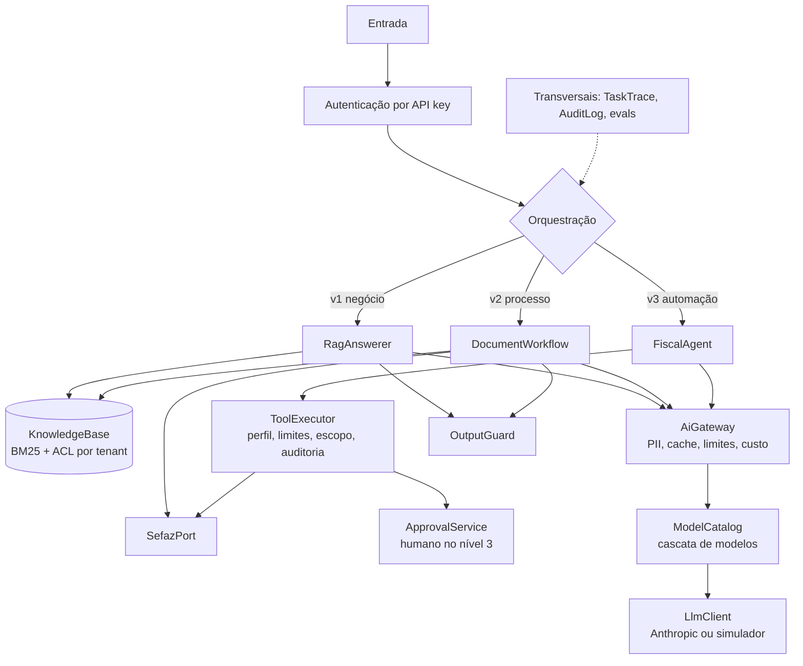

# llm-fiscal-ladder

Implementação de referência de uma **escada de estratégias para projetar soluções com LLM**, usando um assistente fiscal de NF-e como exemplo.

A tese: cada degrau custa mais que o anterior, então **só se sobe quando o eval mostra que o degrau de baixo não resolveu**. Aqui isso é código executável, não recomendação: o gate mede cada degrau, classifica o tipo de falha e diz o que fazer.

```text
## NEGOCIO: RAG com citação da fonte
Degrau 1: Prompt (reprovado)          contem_fato 0/12, cita_fonte 0/12
  Decisão: Erro de conhecimento: suba para contexto/RAG, não para fine-tuning.
Degrau 2: Contexto / RAG (aprovado)   contem_fato 12/12, cita_fonte 12/12
  Decisão: Critérios atendidos: fique neste degrau.

## PROCESSO: Workflow com saída em JSON validado
Degrau 1: Prompt (aprovado)           categoria_correta 12/12
  Decisão: Critérios atendidos: fique neste degrau.

## AUTOMACAO: Agente com ferramentas e aprovação humana
Degrau 2: Contexto / RAG (reprovado)  desfecho 0/8, ferramentas 0/8
  Decisão: A tarefa exige agir: suba para ferramentas.
Degrau 3: Agente + ferramentas (aprovado)  desfecho 8/8, sem_duplicidade 8/8
```

> **O que esses números medem.** Por padrão o gate roda com um simulador determinístico, para funcionar no CI sem chave e sem custo. Ele valida o **sistema ao redor do modelo** (retrieval, ACL, guardrails, políticas de ferramenta, roteamento), não a qualidade de um modelo real. Para isso existe o modo `--live`.

> O cenário fiscal é ilustrativo. Códigos, prazos e regras foram simplificados e a SEFAZ é simulada. Não use como referência fiscal; a fonte oficial é o Manual de Orientação do Contribuinte e a legislação da sua UF.

## Como rodar

Requer Java 21 e Maven 3.9+. Nenhuma chave é necessária no modo padrão.

```bash
mvn verify
```

Isso roda os testes e o gate de evals. O relatório fica em `target/eval-report.md`.

```bash
mvn spring-boot:run
```

Sobe a API em `http://localhost:8080`. As chaves `demo-*` estão em `application.yml` e servem apenas para uso local.

### As três versões do assistente

Antes dos comandos abaixo, defina uma chave de acesso válida. Esta é sintética, com dígito verificador correto:

```bash
export CHAVE=35261111222333000181550010000007771000007775
```

**v1, negócio:** responde com a fonte e não age.

```bash
curl -s localhost:8080/v1/answers -H 'Content-Type: application/json' -H 'X-Api-Key: demo-analista-acme' -d '{"question":"O que significa a rejeicao 204?"}'
```

**v2, processo:** fluxo fixo, saída em JSON validado e somente leitura.

```bash
curl -s localhost:8080/v1/documents/analyze -H 'Content-Type: application/json' -H 'X-Api-Key: demo-analista-acme' -d "{\"xml\":\"<protNFe><infProt><chNFe>$CHAVE</chNFe><cStat>225</cStat><xMotivo>Falha no Schema XML</xMotivo></infProt></protNFe>\"}"
```

**v3, automação:** o agente consulta antes de reenviar.

```bash
curl -s localhost:8080/v1/incidents -H 'Content-Type: application/json' -H 'X-Api-Key: demo-analista-acme' -d "{\"type\":\"TIMEOUT\",\"accessKey\":\"$CHAVE\",\"description\":\"Timeout na autorizacao\"}"
```

Cancelar é irreversível: o agente apenas prepara, e um humano com papel de aprovador decide.

```bash
curl -s localhost:8080/v1/incidents -H 'Content-Type: application/json' -H 'X-Api-Key: demo-analista-acme' -d "{\"type\":\"CANCELAMENTO\",\"accessKey\":\"$CHAVE\",\"description\":\"Erro no valor\"}"
```

Use o `approvalId` devolvido:

```bash
curl -s -X POST localhost:8080/v1/approvals/ID_DA_APROVACAO/approve -H 'X-Api-Key: demo-aprovador-acme'
```

Outros endpoints: `GET /v1/approvals`, `POST /v1/approvals/{id}/reject`, `GET /v1/actions`, `POST /v1/actions/{id}/compensate`, `GET /v1/audit`, `GET /v1/traces/{id}` e `POST /v1/feedback`.

### Com um modelo real

> As chamadas abaixo usam a API da Anthropic e geram custo.

```bash
export ANTHROPIC_API_KEY=sua-chave
```

Para medir o modelo real no golden set, com LLM-juiz:

```bash
mvn spring-boot:run -Dspring-boot.run.arguments="eval --live --judge"
```

Para subir a API usando o modelo real:

```bash
LADDER_LLM=anthropic mvn spring-boot:run
```

### Servidor MCP

Expõe somente ferramentas de leitura, por stdio. Reenvio e cancelamento ficam de fora de propósito: eles dependem das políticas do agente.

```bash
mvn -q -DskipTests package && java -jar target/llm-fiscal-ladder-0.1.0.jar mcp
```

## Arquitetura



O ponto de desenho mais importante: **as garantias estão no código, não no prompt**. O `AgentPolicyTest` usa um modelo adversário que tenta reenviar às cegas, agir em outra nota e cancelar sem permissão, e as políticas seguram mesmo assim.

## Do conceito para o código

| Conceito | Onde está |
|---|---|
| Três tipos de demanda | [`Demand`](src/main/java/dev/llmladder/core/Demand.java) |
| A escada | [`Rung`](src/main/java/dev/llmladder/eval/Rung.java), [`LadderRunner`](src/main/java/dev/llmladder/eval/LadderRunner.java) |
| RAG ou fine-tuning | [`FailureKind`](src/main/java/dev/llmladder/eval/FailureKind.java), [`EscalationAdvisor`](src/main/java/dev/llmladder/eval/EscalationAdvisor.java) |
| Workflow antes de agente | [`DocumentWorkflow`](src/main/java/dev/llmladder/workflow/DocumentWorkflow.java) (prompt chaining + routing) |
| Gateway de IA, PII | [`AiGateway`](src/main/java/dev/llmladder/gateway/AiGateway.java), [`PiiVault`](src/main/java/dev/llmladder/gateway/PiiVault.java) |
| ACL no RAG | [`KnowledgeBase`](src/main/java/dev/llmladder/rag/KnowledgeBase.java): o filtro roda antes do ranking |
| Menor privilégio | [`IncidentType`](src/main/java/dev/llmladder/agent/IncidentType.java), [`ToolExecutor`](src/main/java/dev/llmladder/agent/ToolExecutor.java) |
| Observabilidade | [`TaskTrace`](src/main/java/dev/llmladder/observability/TaskTrace.java): API do OpenTelemetry |
| Evals, golden set, gate no CI | [`eval/`](src/main/java/dev/llmladder/eval), [golden sets](src/main/resources/evals), [`EvalGateTest`](src/test/java/dev/llmladder/EvalGateTest.java) |
| Cuidados com o LLM-juiz | [`LlmJudgeGrader`](src/main/java/dev/llmladder/eval/LlmJudgeGrader.java): rubrica e modelo diferente |
| Produção realimenta o golden set | `POST /v1/feedback`, [`FeedbackLog`](src/main/java/dev/llmladder/api/FeedbackLog.java) |
| Quatro níveis de autonomia | [`AutonomyLevel`](src/main/java/dev/llmladder/agent/AutonomyLevel.java), [`FiscalTools`](src/main/java/dev/llmladder/agent/FiscalTools.java) |
| Idempotência e compensação | [`ActionLog`](src/main/java/dev/llmladder/agent/ActionLog.java), [`ApprovalService`](src/main/java/dev/llmladder/agent/ApprovalService.java) |
| Timeout não é falha | [`SefazPort`](src/main/java/dev/llmladder/fiscal/SefazPort.java): timeout vira `DESCONHECIDO`; o reenvio exige nova consulta |
| OWASP LLM e LGPD | [`InjectionScanner`](src/main/java/dev/llmladder/guard/InjectionScanner.java), [`OutputGuard`](src/main/java/dev/llmladder/guard/OutputGuard.java), `PiiVault`, `AuditLog`, limites do gateway |
| Custo e latência | [`ModelCatalog`](src/main/java/dev/llmladder/llm/ModelCatalog.java), cascata em [`RagAnswerer`](src/main/java/dev/llmladder/rag/RagAnswerer.java), cache no gateway e prompt caching no adaptador |
| Assistente em três versões | v1 `RagAnswerer`, v2 `DocumentWorkflow`, v3 [`FiscalAgent`](src/main/java/dev/llmladder/agent/FiscalAgent.java) |
| MCP | [`McpStdioServer`](src/main/java/dev/llmladder/mcp/McpStdioServer.java) |

### Os quatro níveis de autonomia

| Nível | Ferramenta | Controle no código |
|---|---|---|
| 0, sugere | `/v1/answers`, `/v1/documents/analyze` | Só responde; `needsHuman` quando não há confiança |
| 1, leitura | `consultar_situacao`, `buscar_manual` | Sem efeito colateral |
| 2, reversível | `reenviar_nfe` | Consulta recente confirmando a ausência, chave de idempotência, limite de tentativas |
| 3, irreversível | `solicitar_cancelamento` | Só prepara. Aprovador distinto do solicitante; janela e situação revalidadas na execução |

## Decisões de implementação

- **Fine-tuning e pré-treino não foram implementados.** Os evals deste domínio param nos degraus 1 a 3, então esses degraus não se justificam aqui. Se um erro de comportamento persistir, o `EscalationAdvisor` recomenda avaliar fine-tuning.
- **A extração do XML é determinística,** sem LLM. O XML já tem estrutura, então um parser é mais barato e confiável. O LLM fica com a classificação.
- **O retriever é BM25,** sem banco vetorial: é determinístico e não adiciona infraestrutura. Troque quando um eval de retrieval pedir.
- **O desfecho do agente é calculado pelo que o sistema observou,** nunca pelo texto do modelo.
- **Fallback entre modelos:** com Opus 5.5 e Sonnet 5.5, respostas sem ferramentas usam `fallbacks: "default"` em caso de recusa. No loop do agente, a recusa escala para um humano em vez de trocar de modelo no meio da sessão.

## Limitações conhecidas

Este projeto é uma referência didática, não um sistema pronto para produção:

- A SEFAZ é simulada. Uma integração real exige implementar `SefazPort` com certificado digital e os webservices oficiais.
- Aprovações, auditoria, ações, cache e traces ficam em memória e se perdem ao reiniciar. Produção precisa de armazenamento durável, e a auditoria de um destino imutável.
- As API keys são estáticas. Use OAuth2/JWT.
- O sistema não verifica se a chave de acesso pertence ao tenant que a informou. Num sistema real, essa checagem é obrigatória.
- O mascaramento de PII usa expressões regulares, então nomes e endereços em texto livre passam. Base legal, contrato com o provedor e retenção continuam sendo responsabilidade de quem opera.
- `InjectionScanner` é uma heurística. A proteção real vem de menor privilégio e aprovação humana.
- O `--live` e o adaptador real foram verificados contra um servidor HTTP local que reproduz o formato da API, não contra a API real.
- O servidor MCP é uma implementação mínima, feita à mão, só com o transporte stdio e ferramentas.

## Referências

- Lewis et al. (2020), *Retrieval-Augmented Generation for Knowledge-Intensive NLP Tasks*
- Hu et al. (2021), *LoRA: Low-Rank Adaptation of Large Language Models*
- Dettmers et al. (2023), *QLoRA: Efficient Finetuning of Quantized LLMs*
- Ouyang et al. (2022), *Training language models to follow instructions with human feedback* (InstructGPT)
- Hoffmann et al. (2022), *Training Compute-Optimal Large Language Models* (Chinchilla)
- Zheng et al. (2023), *Judging LLM-as-a-Judge with MT-Bench and Chatbot Arena*
- Chen et al. (2023), *FrugalGPT*
- Anthropic, *Building Effective Agents*
- OWASP, *Top 10 for LLM Applications 2025*
- [Model Context Protocol](https://modelcontextprotocol.io)
